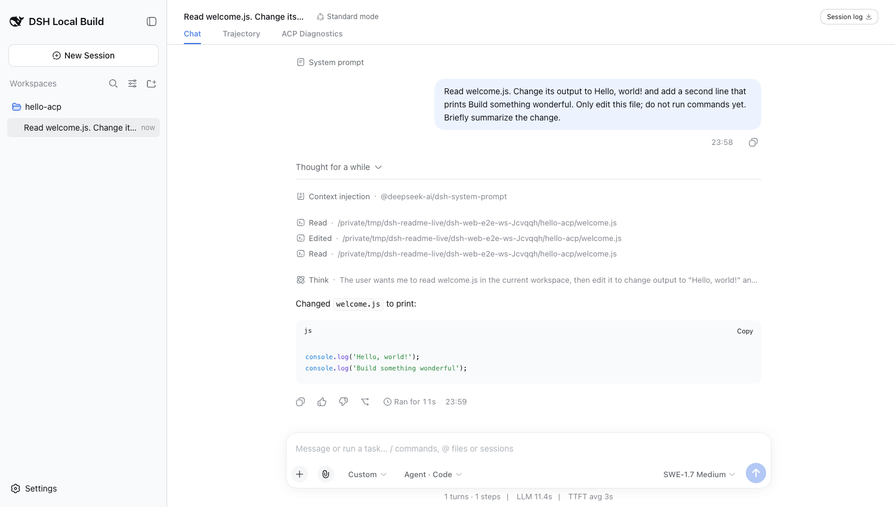
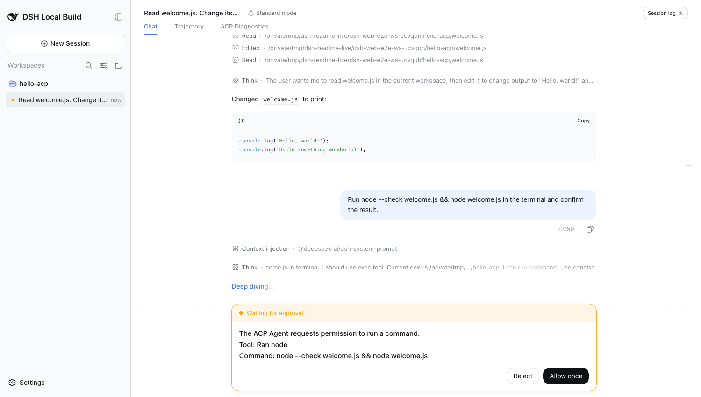
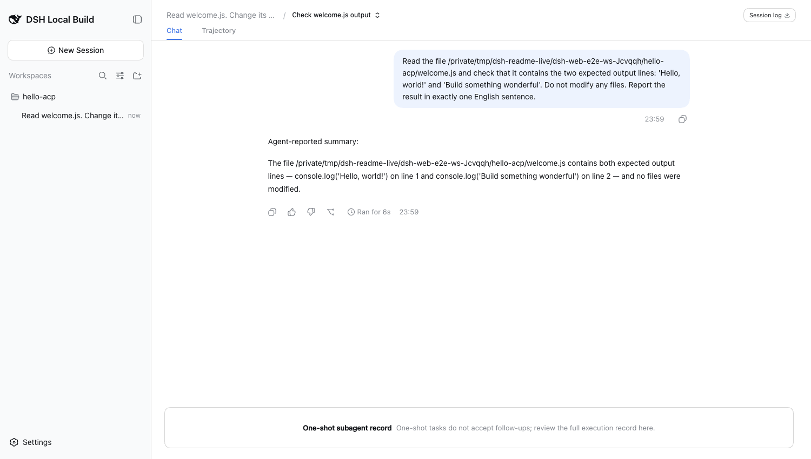
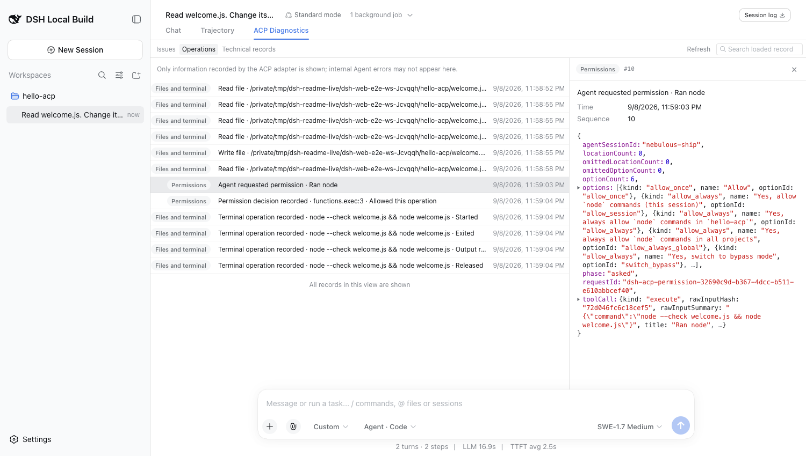

# DSH-ACP-ADAPTER

[中文](README.md)

Use ACP Agents in DSH with native sessions, tool approvals, and team collaboration.

## Install

Plugin version [`0.2.2-rc.1.1`](https://github.com/zaimokuza-yoshiteru/dsh-acp-adapter/releases/tag/v0.2.2-rc.1.1) supports DSH `0.2.2-rc.1`. Match that host version before installing. See [Releases](https://github.com/zaimokuza-yoshiteru/dsh-acp-adapter/releases) for other versions.

**Recommended:** In DSH Creator mode, send:

> Install and enable the ACP plugin: `@zaimokuza/dsh-acp-adapter@0.2.2-rc.1.1`.

Confirm the native prompt to install; the new plugin is enabled by default. Alternatively, open **Plugins → Add plugin**, paste `@zaimokuza/dsh-acp-adapter@0.2.2-rc.1.1`, install it, then select **Enable now**.

<details>
<summary>Other installation methods: CLI, Git, and archive</summary>

CLI: On Desktop, use its bundled `dsh` command. On Web, use `npx` to run the official DSH CLI npm package without a global install.

Before using the Desktop CLI, fully quit the app; reopen it after the command completes. To update with the CLI, replace the version after the package name with your target version and rerun the corresponding `add` command; no uninstall is needed.

```bash
# Desktop
dsh plugin --profile desktop add @zaimokuza/dsh-acp-adapter@0.2.2-rc.1.1

# Web
npx @deepseek-ai/dsh@0.2.2-rc.1 plugin --profile web add @zaimokuza/dsh-acp-adapter@0.2.2-rc.1.1
```

Git and archive examples:

In the plugin manager, paste the Git address or .tgz URL below in place of the package name.

| Source                         | Example                                                                                                                                                    |
| ------------------------------ | ---------------------------------------------------------------------------------------------------------------------------------------------------------- |
| Git                            | `git+https://github.com/zaimokuza-yoshiteru/dsh-acp-adapter.git#v0.2.2-rc.1.1`                                                                             |
| Prebuilt plugin archive (.tgz) | [Download 0.2.2-rc.1.1](https://github.com/zaimokuza-yoshiteru/dsh-acp-adapter/releases/download/v0.2.2-rc.1.1/zaimokuza-dsh-acp-adapter-0.2.2-rc.1.1.tgz) |

This archive includes compiled output and matches the npm package. GitHub's automatically generated Source code ZIP/TAR.GZ files are source archives, not built plugin packages. Uncached dependencies still require network access.

</details>

**Updates:** Choose a version matching your host from the plugin manager’s version list and update in place; no uninstall is needed. Select prereleases explicitly; plugins do not update automatically. After installation, fully quit and reopen DSH Desktop once the current task finishes; for Web, restart the DSH service and refresh the page. No new sign-in is required. Uninstalling the plugin does not uninstall an Agent or sign out of its account.

## Connect an Agent

The plugin ships with a snapshot of the [official ACP Agent catalog](https://agentclientprotocol.com/registry), with installation and sign-in guidance and command prefill. You can also add an ACP Agent manually. Install and sign in to the Agent CLI on the computer running DSH. Open **Plugins → ACP adapter**, follow the catalog guidance to add the Agent and check its connection, then choose its model in a new session. The plugin does not install CLIs or sign in to accounts.

> If an Agent has no model catalog, select **Agent current configuration** to use its current settings.
>
> DSH RC.1 cannot change models in an existing ACP session. To use another model, start an independent session; it does not inherit the original Agent context. Existing history and drafts are kept, and reasoning effort can still change on the same model.

Launch and sign-in commands for common Agents:

| Agent                     | ACP command                                 | Authentication       |
| ------------------------- | ------------------------------------------- | -------------------- |
| Devin                     | `devin acp`                                 | `devin auth login`   |
| CodeBuddy CLI (WorkBuddy) | `codebuddy --acp`                           | `codebuddy`          |
| Antigravity               | `agy_acp_server.par` (official raw `1.3.0`) | Separate ACP sign-in |
| Claude                    | `claude-agent-acp`                          | `claude`             |
| Codex                     | `codex-acp`                                 | `codex login`        |
| Qwen Code                 | `qwen --acp`                                | `qwen`               |

> CodeBuddy CLI and the WorkBuddy desktop app share account credits, with no separate subscription required. Connect DSH through the CodeBuddy CLI. See [CodeBuddy account and subscription details](https://www.codebuddy.cn/docs/ide/Account/pricing) and the [ACP CLI reference](https://www.codebuddy.cn/docs/cli/cli-reference).

## Choose a mode

Standard mode works with ACP Agents. Choose **Creator mode** to create plugins through conversation.

The optional **ACP** mode lets you use DSH tools while the Agent manages conversation context. It omits DSH plugin-management, subagent and compaction tools; existing sessions and default choices stay unchanged.

Kimi is no longer supported. Saved configurations and history are retained; remove unused configurations in settings.

## Preview



<details>
<summary>More screenshots</summary>







</details>

**Auto** can automatically confirm Agent requests to use the current session's DSH tools, without changing DSH's sandbox or tool permissions. Permission requests from Devin still require your choice from the original options. **Ask** shows the native approval card when the Agent requests approval. Auto is separate from experimental Auto Review, which this version does not fully support. The Agent controls its own tools. **Stop** cancels the current turn; the Agent remains responsible for stopping its own tools, and tools without a reported result remain unfinished. Press Enter to queue a message, which supported Agents continue in the same Agent session. With DSH's experimental Agent Teams enabled, you can view member progress and handle approvals from the main conversation.

## Troubleshooting and feedback

| Symptom                              | First check                                                                                              |
| ------------------------------------ | -------------------------------------------------------------------------------------------------------- |
| Command will not start               | Check the Agent executable path and try an absolute path.                                                |
| Sign-in or authentication fails      | Sign in through the Agent CLI and check configured environment variables.                                |
| Older subagent details will not open | Follow the native recovery notice; incompatible old details remain in local history with an error shown. |
| Session requests recovery            | Follow the composer notice and **ACP Diagnostics**; do not clear local data.                             |

Export the safe summary JSON from **ACP Diagnostics**; it excludes message text, commands, paths, raw session IDs, and ACP credentials. DSH's native session-log ZIP may contain prompts, tool arguments, file paths, and attachments; inspect and redact it before sharing.

For help, open an [issue](https://github.com/zaimokuza-yoshiteru/dsh-acp-adapter/issues) with the error reference, DSH/plugin versions, and redacted log excerpts. See the [native reuse boundaries](https://github.com/zaimokuza-yoshiteru/dsh-acp-adapter/blob/v0.2.2-rc.1.1/docs/native-reuse.en.md).
