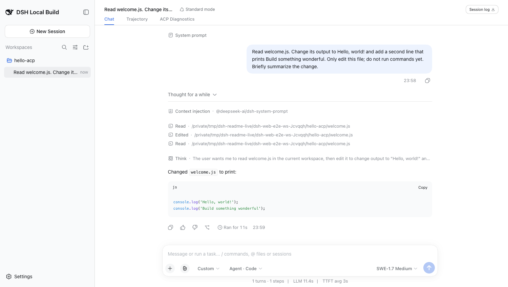
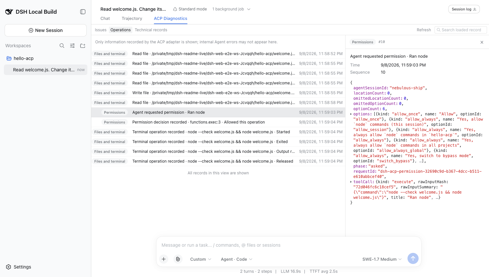

# DSH-ACP-ADAPTER

[中文](README.md)

Use ACP Agents in DSH with native sessions, tool approvals, and team collaboration.

## Install

This guide covers DSH `0.2.2-rc.5` with plugin [`0.2.2-rc.5.2`](https://github.com/zaimokuza-yoshiteru/dsh-acp-adapter/releases/tag/v0.2.2-rc.5.2). For DSH `0.2.2-rc.4`, use [plugin `0.2.2-rc.4.1`](https://github.com/zaimokuza-yoshiteru/dsh-acp-adapter/releases/tag/v0.2.2-rc.4.1).

**Recommended:** In DSH Creator mode, send:

> Install and enable the ACP plugin: `@zaimokuza/dsh-acp-adapter@0.2.2-rc.5.2`.

Confirm the installation when prompted. Alternatively, open **Plugins → Add plugin**, paste `@zaimokuza/dsh-acp-adapter@0.2.2-rc.5.2`, and install it. If prompted, select **Enable now**.

<details>
<summary>Other installation methods: CLI, Git, and archive</summary>

CLI: On Desktop, use its bundled `dsh` command. On Web, use `npx` to run the official DSH CLI npm package without a global install.

Before using the Desktop CLI, fully quit the app; reopen it after the command completes. To update with the CLI, replace the version after the package name with your target version and rerun the corresponding `add` command; no uninstall is needed.

```bash
# Desktop
dsh plugin --profile desktop add @zaimokuza/dsh-acp-adapter@0.2.2-rc.5.2

# Web
npx @deepseek-ai/dsh@0.2.2-rc.5 plugin --profile web add @zaimokuza/dsh-acp-adapter@0.2.2-rc.5.2
```

To install from Git or an archive, paste the Git address or .tgz download URL into the plugin manager.

| Source                         | Example                                                                                                                                                    |
| ------------------------------ | ---------------------------------------------------------------------------------------------------------------------------------------------------------- |
| Git                            | `git+https://github.com/zaimokuza-yoshiteru/dsh-acp-adapter.git#v0.2.2-rc.5.2`                                                                             |
| Prebuilt plugin archive (.tgz) | [Download 0.2.2-rc.5.2](https://github.com/zaimokuza-yoshiteru/dsh-acp-adapter/releases/download/v0.2.2-rc.5.2/zaimokuza-dsh-acp-adapter-0.2.2-rc.5.2.tgz) |

This archive includes compiled output and matches the npm package. GitHub's automatically generated Source code ZIP/TAR.GZ files are source archives, not built plugin packages. Uncached dependencies still require network access.

</details>

To update, choose a version matching DSH in the plugin manager. Select prereleases manually. If a restart is required, wait for the current task to finish, then restart DSH Desktop or restart the Web service and refresh the page. Uninstalling the plugin leaves your Agent CLIs and their sign-ins in place.

## Connect an Agent

1. Install the Agent CLI on the computer running DSH and sign in if required.
2. Open **Plugins → ACP adapter**. Choose an Agent from the [official catalog](https://agentclientprotocol.com/registry) or enter its command manually, then save. Saving starts a connection check. If it fails, resolve the issue shown and select **Re-check**.
3. Start a chat and choose the Agent and model in the model menu. If the Agent lists no models, select its current configuration.

Launch and sign-in commands for common Agents:

| Agent                     | ACP command                                            | Authentication                |
| ------------------------- | ------------------------------------------------------ | ----------------------------- |
| Devin (3000.14.30821+)    | `devin acp`                                            | `devin auth login`            |
| CodeBuddy CLI (WorkBuddy) | `codebuddy --acp`                                      | `codebuddy`                   |
| OpenCode                  | `opencode acp`                                         | Configure your model provider |
| Antigravity               | `agy_acp_server.par` (`agy_acp_server.exe` on Windows) | Separate ACP sign-in          |
| Claude                    | `claude-agent-acp`                                     | `claude`                      |
| Codex                     | `codex-acp`                                            | `codex login`                 |
| Qwen Code                 | `qwen --acp`                                           | `qwen`                        |

> To use WorkBuddy with DSH, connect through the CodeBuddy CLI. See the [ACP CLI reference](https://www.codebuddy.cn/docs/cli/cli-reference) and [CodeBuddy account and subscription details](https://www.codebuddy.cn/docs/ide/Account/pricing).

## Choose a mode

Standard mode works with ACP Agents. Choose **Creator mode** to create plugins through conversation.

Choose the optional **ACP** mode to let the Agent manage conversation context. This mode provides DSH tools and omits DSH plugin management, subagent, and compaction tools.

**Switch models within a conversation.** When starting a CodeBuddy or OpenCode main chat in Standard, Creator, PTC, or Minimal mode, choose **Agent-managed model** in the model menu. Once connected, select the model name beside the composer to switch and continue the conversation. In dedicated **ACP** mode, use the native model picker. Other chats started with a named model can open a new chat in the same mode. The original chat keeps its history and draft.

## Working in a session

- **Approvals.** Choose **Ask** to review each request the Agent makes for DSH tool access. Choose **Auto approve** to allow requests within existing DSH permissions. Devin requests still need your approval. Agents manage their own tools. Support for experimental Auto Review is limited.
- **Queue and stop.** Press Enter during a turn to queue the next message. Agents that support continuation handle it in the same session. **Stop** cancels the current turn. Agents are responsible for stopping their own tools. Tools without a reported result stay unfinished.
- **Members and tasks.** View subagent progress and handle member approvals in the main session. To share tasks, enable DSH’s experimental Agent Teams in the session.

<details>
<summary>View real session examples from an earlier DSH version</summary>






</details>

## Troubleshooting and feedback

| Symptom                              | First check                                                                                              |
| ------------------------------------ | -------------------------------------------------------------------------------------------------------- |
| Command will not start               | Check the Agent executable path and try an absolute path.                                                |
| Sign-in or authentication fails      | Sign in through the Agent CLI and check configured environment variables.                                |
| Older subagent details will not open | Follow the native recovery notice; incompatible old details remain in local history with an error shown. |
| Session requests recovery            | Follow the composer notice and **ACP Diagnostics**; do not clear local data.                             |

Export the safe summary JSON from **ACP Diagnostics**; it excludes message text, commands, paths, raw session IDs, and ACP credentials. DSH's native session-log ZIP may contain prompts, tool arguments, file paths, and attachments; inspect and redact it before sharing.

For help, open an [issue](https://github.com/zaimokuza-yoshiteru/dsh-acp-adapter/issues) with the error reference, DSH/plugin versions, and redacted log excerpts. For this version, see the [native reuse boundaries](https://github.com/zaimokuza-yoshiteru/dsh-acp-adapter/blob/v0.2.2-rc.5.2/docs/native-reuse.en.md).
