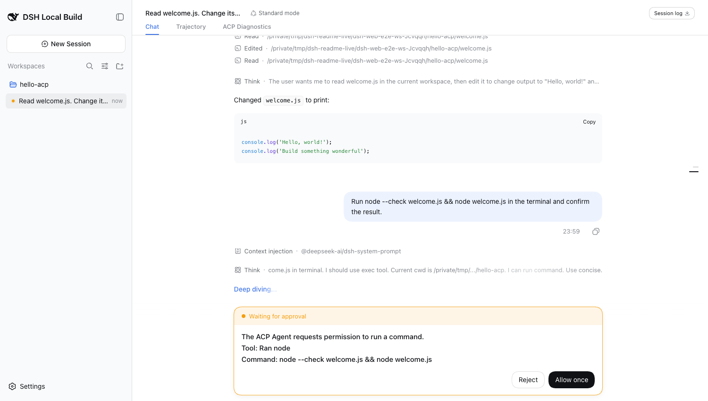
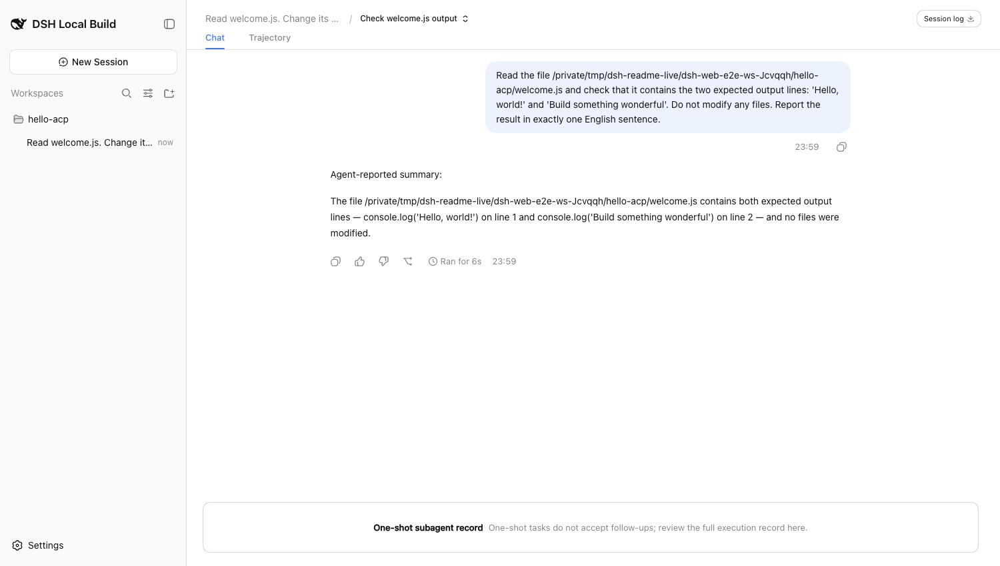

# DSH-ACP-ADAPTER

[中文](README.md)

Use ACP Agents in DSH with native sessions, tool approvals, and team collaboration.

## Install

This guide covers DSH `0.2.2-rc.5` with plugin [`0.2.2-rc.5.5`](https://github.com/zaimokuza-yoshiteru/dsh-acp-adapter/releases/tag/v0.2.2-rc.5.5). For DSH `0.2.2-rc.4`, use [plugin `0.2.2-rc.4.1`](https://github.com/zaimokuza-yoshiteru/dsh-acp-adapter/releases/tag/v0.2.2-rc.4.1).

**Recommended:** In DSH Creator mode, send:

> Install and enable the ACP plugin: `@zaimokuza/dsh-acp-adapter@0.2.2-rc.5.5`.

Confirm the installation when prompted. Alternatively, open **Plugins → Add plugin**, paste `@zaimokuza/dsh-acp-adapter@0.2.2-rc.5.5`, and install it. If prompted, select **Enable now**.

<details>
<summary>Other installation methods: CLI, Git, and archive</summary>

CLI: On Desktop, use its bundled `dsh` command. On Web, use `npx` to run the official DSH CLI npm package without a global install.

Before using the Desktop CLI, fully quit the app; reopen it after the command completes. To update with the CLI, replace the version after the package name with your target version and rerun the corresponding `add` command; no uninstall is needed.

```bash
# Desktop
dsh plugin --profile desktop add @zaimokuza/dsh-acp-adapter@0.2.2-rc.5.5

# Web
npx @deepseek-ai/dsh@0.2.2-rc.5 plugin --profile web add @zaimokuza/dsh-acp-adapter@0.2.2-rc.5.5
```

To install from Git or an archive, paste the Git address or .tgz download URL into the plugin manager.

| Source                         | Example                                                                                                                                                    |
| ------------------------------ | ---------------------------------------------------------------------------------------------------------------------------------------------------------- |
| Git                            | `git+https://github.com/zaimokuza-yoshiteru/dsh-acp-adapter.git#v0.2.2-rc.5.5`                                                                             |
| Prebuilt plugin archive (.tgz) | [Download 0.2.2-rc.5.5](https://github.com/zaimokuza-yoshiteru/dsh-acp-adapter/releases/download/v0.2.2-rc.5.5/zaimokuza-dsh-acp-adapter-0.2.2-rc.5.5.tgz) |

This archive includes compiled output and matches the npm package. GitHub's automatically generated Source code ZIP/TAR.GZ files are source archives, not built plugin packages. Uncached dependencies still require network access.

</details>

To update, choose a version matching DSH in the plugin manager. Select prereleases manually. If a restart is required, wait for the current task to finish, then restart DSH Desktop or restart the Web service and refresh the page. Uninstalling the plugin leaves your Agent CLIs and their sign-ins in place.

## Connect an Agent

1. Install the Agent CLI on the computer running DSH and sign in if required.
2. Open **Plugins → ACP adapter**. Choose an Agent from the [official catalog](https://agentclientprotocol.com/registry) or enter its command manually, then save. Saving starts a connection check. If it fails, resolve the issue shown and select **Re-check**.
3. Start a chat and choose the Agent and model in the model menu. If the Agent lists no models, select its current configuration.

Launch and sign-in commands for common Agents:

| Agent                                                      | ACP command        | Authentication                |
| ---------------------------------------------------------- | ------------------ | ----------------------------- |
| Devin (3000.14.30821+)                                     | `devin acp`        | `devin auth login`            |
| CodeBuddy CLI (WorkBuddy)                                  | `codebuddy --acp`  | `codebuddy`                   |
| OpenCode                                                   | `opencode acp`     | Configure your model provider |
| [Antigravity CLI](https://antigravity.google/docs/cli/acp) | `agy acp`          | `agy acp --login`             |
| Claude                                                     | `claude-agent-acp` | `claude`                      |
| Codex                                                      | `codex-acp`        | `codex login`                 |
| Qwen Code                                                  | `qwen --acp`       | `qwen`                        |

Choose **Usage** next to the model picker to check the current Agent’s account. The panel stays open while you write or use other menus. Close it when you’re done. Codex reports its plan and quota, Devin reports its plan, and Antigravity on macOS can check both on request. Plugin details also offer account information. CodeBuddy (including WorkBuddy), Claude, Qwen, OpenCode and GitHub Copilot link to official usage guides.

## Choose a mode

Standard mode works with ACP Agents. Choose **Creator mode** to create plugins through conversation.

Choose the optional **ACP** mode to let the Agent manage conversation context. This mode provides DSH tools and omits DSH plugin management, subagent, and compaction tools.

Use the selector beside the ACP composer to choose a work or permission mode offered by the current Agent. You can choose before your first message. The adapter waits for the Agent to confirm before sending. Use `/permission` to change permissions for DSH bridge tools.

**Switch models within a conversation.** Choose a CodeBuddy or OpenCode model directly in the model menu. The adapter confirms the model with the Agent before sending. You can switch models in the same main conversation. Switching Agents or moving between ACP and native DSH opens a blank chat in the same mode by default. To continue the work, choose **Hand off session**, edit the document prepared by the source conversation, and send it. History access is enabled by default. The new chat can look up user and assistant text from turns completed before the handoff. Clear the checkbox to share only the document. Your original draft stays in place.

From your main chat, you can ask the Agent to open an independent session with a named model from an installed Agent. The `create_agent_session` tool accepts an optional first task. You can open the new chat from the original conversation. The independent chat has no access to the source history.

## Working in a session

- **AI approval.** If your organization restricts an Agent’s automatic modes, turn on AI approval in plugin details to reduce manual prompts. It is off by default. Eligible Devin and OpenCode requests can be allowed once after review. You decide when the model flags a request as high risk or cannot assess it. Each assessment appears in the session audit. [Supported configurations](docs/permission-policy.en.md#ai-approval)
- **CodeBuddy security review.** The session audit shows security outcomes CodeBuddy reports for tools in this session, including blocked calls, results, and sandbox requests, and sensitive data protection. Choose CodeBuddy’s Default mode in the ACP preset when writes need individual confirmation.
- **Queue and stop.** Press Enter during a turn to queue the next message. Agents that support continuation handle it in the same session. **Stop** cancels the current turn. Agents are responsible for stopping their own tools. Tools without a reported result stay unfinished.
- **Members and tasks.** View subagent progress and handle member approvals in the main session. To share tasks, turn on **Agent Teams** in that session.

<details>
<summary>View real session examples from an earlier DSH version</summary>







</details>

## DSH experimental features with ACP

These are the official experimental plugins in DSH `0.2.2-rc.5`. Tool-based features require a mode that provides the corresponding DSH tools and an Agent that can call them. [Official RC.5 list](https://github.com/deepseek-ai/deepseek-harness/blob/dsh-v0.2.2-rc.5/packages/util/official-bundles/src/plugin-manager.ts)

| DSH feature                      | In an ACP session          | What you can use                                                                                                                                                                                            |
| -------------------------------- | -------------------------- | ----------------------------------------------------------------------------------------------------------------------------------------------------------------------------------------------------------- |
| Voice input                      | Supported                  | Transcription goes into the draft. The Agent receives text when you send it.                                                                                                                                |
| Machine translation of reasoning | Supported                  | Expand reasoning reported by the Agent to see its translation or the original.                                                                                                                              |
| Session search                   | Supported                  | The Agent can search authorized history in the current workspace through DSH tools.                                                                                                                         |
| Ralph loops                      | Supported                  | Each round starts a fresh ACP child with a task handoff. You can cancel the loop.                                                                                                                           |
| Developer tools                  | Partial                    | Inspect DSH session events and statistics. Internal operations, usage and costs that the Agent never reports cannot be reconstructed.                                                                       |
| DeepSeek chat import             | Partial                    | Imported history remains readable. Choosing ACP opens a blank session and leaves the original history and draft in place.                                                                                   |
| Change requests & worktrees      | Partial                    | Link a GitHub PR manually in the DSH sidebar. A push from the Agent’s own terminal may go undetected.                                                                                                       |
| Git worktrees                    | Conditional                | Enable through **Change requests & worktrees**. Moving a bound ACP session to a new directory through a tool requires an Agent that can fork its context.                                                   |
| Auto authorization review        | Unsupported for ACP review | DSH’s same-model reviewer cannot use an ACP model or take over the Agent’s own approval requests. Devin and OpenCode can use the plugin’s separate [AI approval](docs/permission-policy.en.md#ai-approval). |
| Conversation-following titles    | Requires a native model    | The current ACP model cannot generate these titles. You can configure a separate native model for the DSH title service.                                                                                    |
| Custom plugin indexes            | Host feature               | Discover and install DSH plugins in the Plugins page’s Discover tab. Use the Agent registry in plugin details to add an ACP Agent.                                                                          |
| DSH badge skill                  | Via DSH skills             | Modes with the DSH skill tool can load `dsh-badge`. Badge generation has no ACP-specific end-to-end verification.                                                                                           |
| Computer use                     | Unverified                 | The official entry requires a macOS host, PTC mode and system permissions. Operating a real app from ACP through PTC is unverified.                                                                         |
| Personalized recommendations     | Unverified                 | Plugin suggestions and page creation cards require the main session to load the relevant skill first. The complete ACP flow through enabling a plugin or generating a page is unverified.                   |
| LiveShare Session Sharing        | Unverified                 | DSH manages sharing and access. A remote viewer continuing a conversation, answering approvals or forking private ACP history is unverified.                                                                |

**Other optional features.** RC.5 persistent terminals have no separate plugin switch. When DSH supplies the terminal tools, an ACP Agent can open, read, write and interrupt its own session’s terminals. Agent Teams has a per-session switch. The on-demand Claude Code and Codex subagents handle delegated tasks separately from choosing an ACP main session in the model menu.

<details>
<summary>DSH experiments that require manual deployment</summary>

| Component                                             | ACP scope                                                                                                                                                         |
| ----------------------------------------------------- | ----------------------------------------------------------------------------------------------------------------------------------------------------------------- |
| OAR subagents                                         | A configured runtime and the `subagent_oar` tool allow an ACP Agent to delegate a separate task. Individual runtime combinations have no end-to-end verification. |
| Claude Code and Codex command hooks, Claude Code Mods | These integrate with DSH events or tools. The external Agent’s CLI still controls execution and approvals for its own tools.                                      |
| Browser control, alternative CUA drivers, Python PTC  | These require explicit host configuration. ACP use with each runtime is unverified.                                                                               |
| GitHub webhooks                                       | DSH receives deliveries and creates sessions. The complete path from a webhook to an ACP task is unverified.                                                      |
| Browser Web Worker preview                            | A browser-only worker cannot launch a local Agent CLI.                                                                                                            |

[RC.5 experimental component catalog](https://github.com/deepseek-ai/deepseek-harness/tree/dsh-v0.2.2-rc.5/packages/experimental)

</details>

## Troubleshooting and feedback

| Symptom                              | First check                                                                                              |
| ------------------------------------ | -------------------------------------------------------------------------------------------------------- |
| Command will not start               | Check the Agent executable path and try an absolute path.                                                |
| Sign-in or authentication fails      | Sign in through the Agent CLI and check configured environment variables.                                |
| Older subagent details will not open | Follow the native recovery notice; incompatible old details remain in local history with an error shown. |
| Session requests recovery            | Follow the composer notice and **ACP Diagnostics**; do not clear local data.                             |

Export the safe summary JSON from **ACP Diagnostics**; it excludes message text, commands, paths, raw session IDs, and ACP credentials. DSH's native session-log ZIP may contain prompts, tool arguments, file paths, and attachments; inspect and redact it before sharing.

For help, open an [issue](https://github.com/zaimokuza-yoshiteru/dsh-acp-adapter/issues) with the error reference, DSH/plugin versions, and redacted log excerpts. For this version, see the [native reuse boundaries](https://github.com/zaimokuza-yoshiteru/dsh-acp-adapter/blob/v0.2.2-rc.5.5/docs/native-reuse.en.md).
