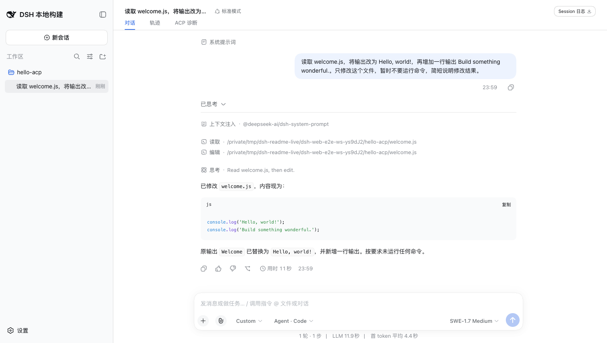
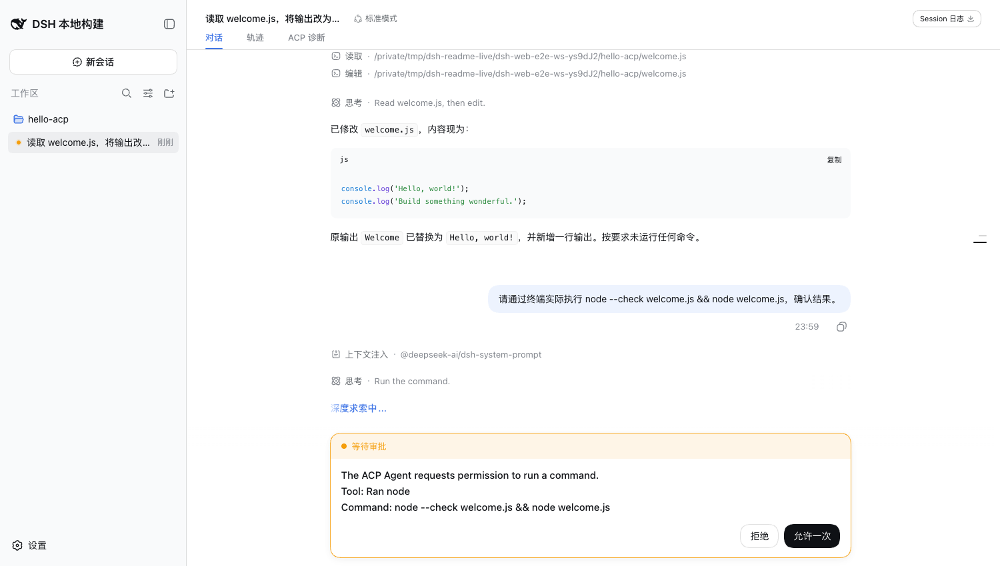
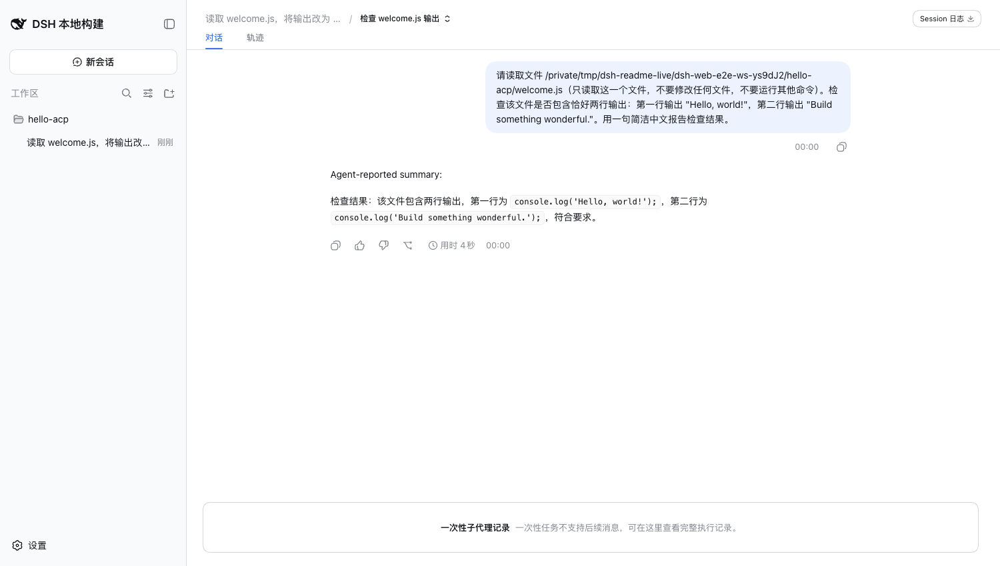

# DSH-ACP-ADAPTER

[English](README.en.md)

在 DSH 中使用 ACP Agent，沿用原生会话、工具审批和团队协作。

## 安装

本页适用于 DSH `0.2.2-rc.5` 和插件 [`0.2.2-rc.5.4`](https://github.com/zaimokuza-yoshiteru/dsh-acp-adapter/releases/tag/v0.2.2-rc.5.4)。如果使用 DSH `0.2.2-rc.4`，请选择[插件 `0.2.2-rc.4.1`](https://github.com/zaimokuza-yoshiteru/dsh-acp-adapter/releases/tag/v0.2.2-rc.4.1)。

**推荐：** 在 DSH 创造模式中发送：

> 请安装并启用 ACP 插件：`@zaimokuza/dsh-acp-adapter@0.2.2-rc.5.4`。

按提示确认安装。也可打开 **插件 → 添加插件**，粘贴 `@zaimokuza/dsh-acp-adapter@0.2.2-rc.5.4`。如果安装完成后提示启用，选择 **立即启用**。

<details>
<summary>其他安装方式：命令行、Git 与压缩包</summary>

命令行：Desktop 使用其自带的 `dsh` 命令；Web 使用 `npx` 运行官方 DSH CLI npm 包，无需全局安装。

使用 Desktop CLI 前先完全退出应用，执行后重新打开。更新时将包名后的版本号替换为目标版本，再运行对应命令，无需先卸载。

```bash
# Desktop
dsh plugin --profile desktop add @zaimokuza/dsh-acp-adapter@0.2.2-rc.5.4

# Web
npx @deepseek-ai/dsh@0.2.2-rc.5 plugin --profile web add @zaimokuza/dsh-acp-adapter@0.2.2-rc.5.4
```

使用 Git 或压缩包安装时，将下表的 Git 地址或 .tgz 下载地址粘贴到插件管理器。

| 来源              | 示例                                                                                                                                                   |
| ----------------- | ------------------------------------------------------------------------------------------------------------------------------------------------------ |
| Git               | `git+https://github.com/zaimokuza-yoshiteru/dsh-acp-adapter.git#v0.2.2-rc.5.4`                                                                         |
| 预构建插件包 .tgz | [下载 0.2.2-rc.5.4](https://github.com/zaimokuza-yoshiteru/dsh-acp-adapter/releases/download/v0.2.2-rc.5.4/zaimokuza-dsh-acp-adapter-0.2.2-rc.5.4.tgz) |

此包包含编译产物，与 npm 发布包一致。GitHub 自动生成的 Source code ZIP/TAR.GZ 是源码归档，不是构建后的插件包；未缓存的依赖仍需联网安装。

</details>

更新时，在插件管理器中选择与 DSH 匹配的版本。预发布版本需手动选择。若提示需要重启，等当前任务结束后重启 DSH 桌面应用，或重启 Web 服务并刷新页面。卸载插件会保留 Agent CLI 及其登录状态。

## 连接 Agent

1. 在运行 DSH 的电脑上安装 Agent CLI，按需登录。
2. 打开 **插件 → ACP 适配器**，从[官方 Agent 目录](https://agentclientprotocol.com/registry)选择 Agent 或手动填写启动命令，并保存，插件会自动检查连接。检查失败时，按提示处理并点击**重新检查**。
3. 新建会话，在模型菜单选择 Agent 和模型。如果 Agent 没有列出模型，选择其当前配置。

常用 Agent 的启动与登录方式：

| Agent                                                      | ACP 命令           | 认证                 |
| ---------------------------------------------------------- | ------------------ | -------------------- |
| Devin（3000.14.30821+）                                    | `devin acp`        | `devin auth login`   |
| CodeBuddy CLI（WorkBuddy）                                 | `codebuddy --acp`  | `codebuddy`          |
| OpenCode                                                   | `opencode acp`     | 按所选模型服务商配置 |
| [Antigravity CLI](https://antigravity.google/docs/cli/acp) | `agy acp`          | `agy acp --login`    |
| Claude                                                     | `claude-agent-acp` | `claude`             |
| Codex                                                      | `codex-acp`        | `codex login`        |
| Qwen Code                                                  | `qwen --acp`       | `qwen`               |

> WorkBuddy 用户可通过 CodeBuddy CLI 接入 DSH。见 [ACP 命令参考](https://www.codebuddy.cn/docs/cli/cli-reference)。套餐与积分可在 [CodeBuddy 个人主页](https://www.codebuddy.cn/docs/ide/Account/usage)查看。

插件详情可通过本机已有登录显示 Codex 套餐与额度、Devin 套餐。在 macOS 上，点击 Antigravity 的「查看套餐与额度」即可查询。可见的额度和重置时间取决于账户。

## 选择模式

标准模式可直接使用 ACP Agent。需要通过对话创建插件时，选择**创造模式**。

如需让 Agent 管理对话上下文，可选择 **ACP** 模式。此模式提供 DSH 工具，不加载 DSH 的插件管理、子代理和压缩工具。

在 **ACP** 模式的输入框旁选择当前 Agent 提供的工作或权限模式。首条消息可以先选模式，Agent 确认后才会发送。DSH 桥接工具的权限仍可通过 `/permission` 调整。

**在会话中切换模型**。在模型菜单里直接选择 CodeBuddy 或 OpenCode 的具体模型。插件会在发送前向 Agent 核对所选模型。同一个 Agent 的主会话可以换模型接着聊；改用另一个 Agent 或 DSH 原生模型时，会按原模式另开会话，历史和草稿留在原处。

## 使用会话

- **AI 审批**。企业限制 Agent 的自动模式时，可在插件详情页开启 AI 审批，减少重复确认。默认关闭。支持的 Devin 和 OpenCode 请求经审查可允许一次，模型标为高风险或无法判断的请求由你确认，每次判断均可在会话审计中查看。[支持范围](docs/permission-policy.md#ai-审批)
- **CodeBuddy 安全审查**。会话审计会显示 CodeBuddy 对本会话工具报告的安全结果，包括拦截工具调用、工具结果或沙箱权限请求，以及保护敏感数据。常规自动放行由 CodeBuddy 内部处理。
- **排队与停止**。运行中按 Enter 可将下一条消息加入队列，支持续聊的 Agent 会在同一会话处理。点击停止按钮可取消当前轮次。Agent 负责停止其自带工具，未报告结果的工具会保留为未完成。
- **成员与任务**。在主会话中可查看子代理进度并处理成员审批。需要共享任务时，打开本会话的 **Agent Teams** 开关。

<details>
<summary>查看实际会话示例（早期版本界面）</summary>








</details>

## DSH 实验性功能与 ACP

下表覆盖 DSH `0.2.2-rc.5` 的官方实验性插件。工具类功能还需要当前模式提供相应的 DSH 工具，且 Agent 能调用这些工具。[RC.5 官方清单](https://github.com/deepseek-ai/deepseek-harness/blob/dsh-v0.2.2-rc.5/packages/util/official-bundles/src/plugin-manager.ts)

| DSH 功能           | 在 ACP 会话中   | 使用范围                                                                                                                                           |
| ------------------ | --------------- | -------------------------------------------------------------------------------------------------------------------------------------------------- |
| 语音输入           | 支持            | 转写结果先进入草稿。确认发送后，Agent 收到文字。                                                                                                   |
| 思考过程机器翻译   | 支持            | 可翻译 Agent 已上报并在界面展开的思考内容，也可查看原文。                                                                                          |
| 会话搜索           | 支持            | Agent 可通过 DSH 工具检索当前工作区授权范围内的历史。                                                                                              |
| Ralph 循环         | 支持            | 每轮使用新的 ACP 子会话，传递任务交接信息，可取消。                                                                                                |
| 开发者工具         | 部分支持        | 可查看宿主会话记录和统计。Agent 未上报的用量、费用和内部操作无法还原。                                                                             |
| DeepSeek 会话导入  | 部分支持        | 可查看导入的历史。选择 ACP 时另开空白会话，历史与草稿留在原处。                                                                                    |
| 变更请求与工作树   | 部分支持        | 可在 DSH 侧栏手动关联 GitHub PR。Agent 自带终端执行的推送可能不会被自动发现。                                                                      |
| Git 工作树         | 有条件支持      | 通过「变更请求与工作树」启用。已绑定的 ACP 会话需要 Agent 支持保留上下文的分叉，才能随工具切换目录。                                               |
| 自动授权审查       | 不支持 ACP 审查 | DSH 的同模型审查无法用 ACP 模型评审，也不会接管 Agent 自己的审批请求。Devin 和 OpenCode 可另用插件的[AI 审批](docs/permission-policy.md#ai-审批)。 |
| 随对话更新的标题   | 需原生模型      | 沿用当前 ACP 模型生成标题不可用。可为 DSH 标题服务单独指定原生模型。                                                                               |
| 自定义插件索引     | 宿主独立        | 在 DSH 插件页的「发现」中浏览和安装插件。添加 ACP Agent 使用插件详情页里的 Agent 目录。                                                            |
| DSH 徽章技能       | 通过 DSH 技能   | 当模式提供 DSH 技能工具时，可读取 `dsh-badge`。徽章生成尚无 ACP 专项验收。                                                                         |
| Computer Use       | 尚未验证        | 官方入口限 macOS 宿主的 PTC 模式，需系统权限。ACP 经 PTC 操作真实应用的完整流程尚未验证。                                                          |
| 个性化推荐         | 尚未验证        | 插件推荐与页面创建卡片要求主会话先读取指定技能。ACP 中从提出推荐到点击启用或生成页面的完整流程尚未验证。                                           |
| LiveShare 会话分享 | 尚未验证        | DSH 管理分享和访问权限。访客在远端续聊、审批及分叉 ACP 私有历史尚未验证。                                                                          |

**其他可选入口。** RC.5 的持久终端没有单独插件开关；宿主提供终端工具时，ACP 可打开、读写和取消自己会话的终端。Agent Teams 使用会话开关。官方按需安装的 Claude Code、Codex 子代理用于委派任务，与在模型菜单中选择 ACP 主会话是两个入口。

<details>
<summary>需要手动部署的 DSH 实验组件</summary>

| 组件                                           | ACP 范围                                                                                          |
| ---------------------------------------------- | ------------------------------------------------------------------------------------------------- |
| OAR 子代理                                     | 配置运行时并提供 `subagent_oar` 工具后，可以从 ACP 委派独立任务。具体运行时的端到端流程尚未验证。 |
| Claude Code / Codex 命令钩子、Claude Code Mods | 接入宿主的事件或工具。外部 Agent 自带工具的执行与授权仍由其 CLI 处理。                            |
| 浏览器控制、其他 CUA 驱动、Python PTC          | 需要宿主单独配置相应运行时。ACP 与各驱动的组合尚未验证。                                          |
| GitHub Webhook                                 | DSH 接收事件并创建会话。Webhook 触发 ACP 任务的完整链路尚未验证。                                 |
| 浏览器 Web Worker 预览                         | 不支持在纯浏览器 Worker 中启动本机 Agent CLI。                                                    |

[RC.5 实验组件目录](https://github.com/deepseek-ai/deepseek-harness/tree/dsh-v0.2.2-rc.5/packages/experimental)

</details>

## 排障与反馈

| 现象                 | 先检查                                                         |
| -------------------- | -------------------------------------------------------------- |
| 命令无法启动         | 核对 Agent 可执行文件路径，尝试填写绝对路径。                  |
| 登录或认证失败       | 在 Agent CLI 登录，并检查已配置的环境变量。                    |
| 旧子代理详情无法打开 | 查看原生恢复提示；不兼容的旧详情会保留在本地记录中并显示错误。 |
| 会话提示需要恢复     | 按输入栏提示和 **ACP 诊断** 操作，不要清空本地数据。           |

在 **ACP 诊断**中可导出安全摘要 JSON；其中不含消息正文、命令、路径、原始会话 ID 或 ACP 凭据。DSH 原生会话日志 ZIP 可能含提示词、工具参数、文件路径和附件；分享前请检查并移除敏感信息。

需要求助时，向 [Issue](https://github.com/zaimokuza-yoshiteru/dsh-acp-adapter/issues) 附上错误编号、DSH/插件版本和已脱敏的日志片段。本版的技术边界见[原生复用说明](https://github.com/zaimokuza-yoshiteru/dsh-acp-adapter/blob/v0.2.2-rc.5.4/docs/native-reuse.md)。
