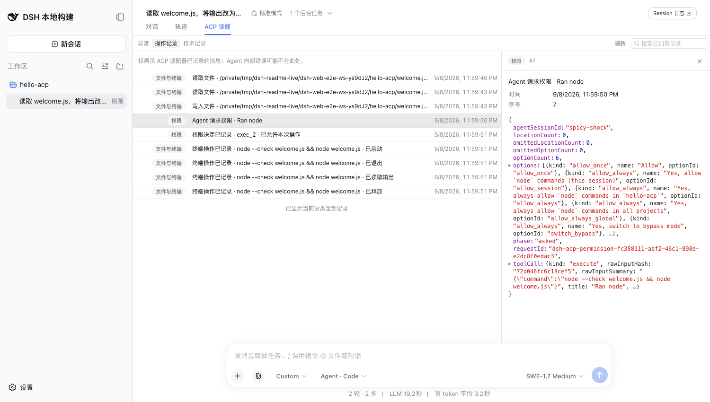

# DSH-ACP-ADAPTER

[English](README.en.md)

在 DSH 中使用 ACP Agent，沿用原生会话、工具审批和团队协作。

## 安装

本页适用于 DSH `0.2.2-rc.5` 和插件 [`0.2.2-rc.5.2`](https://github.com/zaimokuza-yoshiteru/dsh-acp-adapter/releases/tag/v0.2.2-rc.5.2)。如果使用 DSH `0.2.2-rc.4`，请选择[插件 `0.2.2-rc.4.1`](https://github.com/zaimokuza-yoshiteru/dsh-acp-adapter/releases/tag/v0.2.2-rc.4.1)。

**推荐：** 在 DSH 创造模式中发送：

> 请安装并启用 ACP 插件：`@zaimokuza/dsh-acp-adapter@0.2.2-rc.5.2`。

按提示确认安装。也可打开 **插件 → 添加插件**，粘贴 `@zaimokuza/dsh-acp-adapter@0.2.2-rc.5.2`。如果安装完成后提示启用，选择 **立即启用**。

<details>
<summary>其他安装方式：命令行、Git 与压缩包</summary>

命令行：Desktop 使用其自带的 `dsh` 命令；Web 使用 `npx` 运行官方 DSH CLI npm 包，无需全局安装。

使用 Desktop CLI 前先完全退出应用，执行后重新打开。更新时将包名后的版本号替换为目标版本，再运行对应命令，无需先卸载。

```bash
# Desktop
dsh plugin --profile desktop add @zaimokuza/dsh-acp-adapter@0.2.2-rc.5.2

# Web
npx @deepseek-ai/dsh@0.2.2-rc.5 plugin --profile web add @zaimokuza/dsh-acp-adapter@0.2.2-rc.5.2
```

使用 Git 或压缩包安装时，将下表的 Git 地址或 .tgz 下载地址粘贴到插件管理器。

| 来源              | 示例                                                                                                                                                   |
| ----------------- | ------------------------------------------------------------------------------------------------------------------------------------------------------ |
| Git               | `git+https://github.com/zaimokuza-yoshiteru/dsh-acp-adapter.git#v0.2.2-rc.5.2`                                                                         |
| 预构建插件包 .tgz | [下载 0.2.2-rc.5.2](https://github.com/zaimokuza-yoshiteru/dsh-acp-adapter/releases/download/v0.2.2-rc.5.2/zaimokuza-dsh-acp-adapter-0.2.2-rc.5.2.tgz) |

此包包含编译产物，与 npm 发布包一致。GitHub 自动生成的 Source code ZIP/TAR.GZ 是源码归档，不是构建后的插件包；未缓存的依赖仍需联网安装。

</details>

更新时，在插件管理器中选择与 DSH 匹配的版本。预发布版本需手动选择。若提示需要重启，等当前任务结束后重启 DSH 桌面应用，或重启 Web 服务并刷新页面。卸载插件会保留 Agent CLI 及其登录状态。

## 连接 Agent

1. 在运行 DSH 的电脑上安装 Agent CLI，按需登录。
2. 打开 **插件 → ACP 适配器**，从[官方 Agent 目录](https://agentclientprotocol.com/registry)选择 Agent 或手动填写启动命令，并保存，插件会自动检查连接。检查失败时，按提示处理并点击**重新检查**。
3. 新建会话，在模型菜单选择 Agent 和模型。如果 Agent 没有列出模型，选择其当前配置。

常用 Agent 的启动与登录方式：

| Agent                      | ACP 命令                                                | 认证                 |
| -------------------------- | ------------------------------------------------------- | -------------------- |
| Devin（3000.14.30821+）    | `devin acp`                                             | `devin auth login`   |
| CodeBuddy CLI（WorkBuddy） | `codebuddy --acp`                                       | `codebuddy`          |
| OpenCode                   | `opencode acp`                                          | 按所选模型服务商配置 |
| Antigravity                | `agy_acp_server.par`（Windows 为 `agy_acp_server.exe`） | ACP 独立登录         |
| Claude                     | `claude-agent-acp`                                      | `claude`             |
| Codex                      | `codex-acp`                                             | `codex login`        |
| Qwen Code                  | `qwen --acp`                                            | `qwen`               |

> WorkBuddy 用户可通过 CodeBuddy CLI 接入 DSH。参见 [ACP 命令参考](https://www.codebuddy.cn/docs/cli/cli-reference)和 [CodeBuddy 账号与订阅说明](https://www.codebuddy.cn/docs/ide/Account/pricing)。

## 选择模式

标准模式可直接使用 ACP Agent。需要通过对话创建插件时，选择**创造模式**。

如需让 Agent 管理对话上下文，可选择 **ACP** 模式。此模式提供 DSH 工具，不加载 DSH 的插件管理、子代理和压缩工具。

**在会话中切换模型**。在标准、创造、PTC 或极简模式新建 CodeBuddy 或 OpenCode 主会话时，可在模型菜单选择 **由 Agent 管理模型**。连接后，点击输入区旁的模型名即可切换并继续原对话。专用 **ACP** 模式通过原生模型选择器切换。其他按具体模型创建的会话可以按原模式另开，历史和草稿留在原会话。

## 使用会话

- **审批**。选择「询问」可逐次审批 Agent 的 DSH 工具请求。选择「自动批准」后，DSH 会自动处理已有权限范围内的授权。Devin 发出的请求仍需你确认。Agent 自带工具由 Agent 管理。实验性 Auto Review 尚未完整支持。
- **排队与停止**。运行中按 Enter 可将下一条消息加入队列，支持续聊的 Agent 会在同一会话处理。点击停止按钮可取消当前轮次。Agent 负责停止其自带工具，未报告结果的工具会保留为未完成。
- **成员与任务**。在主会话中可查看子代理进度并处理成员审批。需要共享任务时，在会话中启用 DSH 的实验性 Agent Teams。

<details>
<summary>查看实际会话示例（早期版本界面）</summary>




</details>

## 排障与反馈

| 现象                 | 先检查                                                         |
| -------------------- | -------------------------------------------------------------- |
| 命令无法启动         | 核对 Agent 可执行文件路径，尝试填写绝对路径。                  |
| 登录或认证失败       | 在 Agent CLI 登录，并检查已配置的环境变量。                    |
| 旧子代理详情无法打开 | 查看原生恢复提示；不兼容的旧详情会保留在本地记录中并显示错误。 |
| 会话提示需要恢复     | 按输入栏提示和 **ACP 诊断** 操作，不要清空本地数据。           |

在 **ACP 诊断**中可导出安全摘要 JSON；其中不含消息正文、命令、路径、原始会话 ID 或 ACP 凭据。DSH 原生会话日志 ZIP 可能含提示词、工具参数、文件路径和附件；分享前请检查并移除敏感信息。

需要求助时，向 [Issue](https://github.com/zaimokuza-yoshiteru/dsh-acp-adapter/issues) 附上错误编号、DSH/插件版本和已脱敏的日志片段。本版的技术边界见[原生复用说明](https://github.com/zaimokuza-yoshiteru/dsh-acp-adapter/blob/v0.2.2-rc.5.2/docs/native-reuse.md)。
